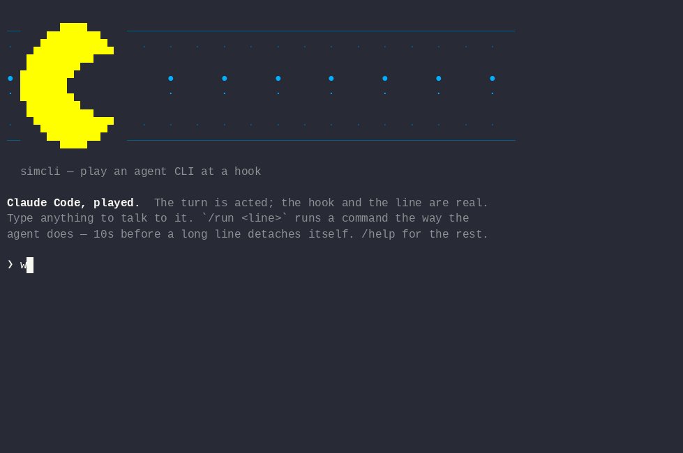

# JobBox

### An agent that has to wait should hand the waiting to Monitor.

Not sitting on a command, not a `sleep` loop, not polling — Monitor runs
the wait in the background and wakes the agent the moment the job ends,
with the answer. Agents do not do it by themselves: on one
machine, two months held 1621 hand-written `until … sleep` loops, each an
agent waiting on its own. JobBox exists to make Monitor the path of least
resistance.

**It wraps every command your agent runs.** The quick ones come back
untouched — output as written, exit code unchanged, as though nothing
were there. The slow ones **detach themselves**, hand the agent its turn
back, and tell it where the waiting goes.

Nobody judges in advance which is which. That judgement is the thing
everybody gets wrong, so JobBox does not make it: it runs the line and
finds out. `jbx gain` counts what that gave back.

JobBox is the project; `jbx` is the command. One binary — Rust,
`serde_json` and `yaml-rust2`, nothing else. Linux, macOS, Windows.

## Five agent CLIs

```console
$ jbx hook --list
claude   Bash                 PreToolUse   ~/.claude/settings.json
gemini   run_shell_command    BeforeTool   ~/.gemini/settings.json
droid    Execute              PreToolUse   declare by hand
cursor   Shell                preToolUse   declare by hand  (no unasked endings)
copilot  bash                 preToolUse   declare by hand
```

They agree on almost nothing — not the name of the shell tool, not the
event, not the shape of the answer, not the file it is declared in.
`jbx init` handles the first two; the rest take one block of JSON, and
**[CLI-AI.md](CLI-AI.md) has the exact block for each**, along with the
two it deliberately does not support and why.

## Install

```console
$ curl -fsSL https://raw.githubusercontent.com/quazardous/jobbox/main/install.sh | sh
```

It checks the download against the sums published with the release, puts
it on your `PATH`, and **asks** before declaring its hooks — they go in a
settings file other tools share. On Windows, `irm
https://raw.githubusercontent.com/quazardous/jobbox/main/install.ps1 |
iex`, and [WINDOWS.md](WINDOWS.md) has the rest. No script at all:
`cargo install --git https://github.com/quazardous/jobbox`, then
`jbx init` — that builds `main`, and `--tag` builds a release. On Claude
Code, `jbx init` also places the skills `/jbx`, `/jbx-after` and
`/jbx-slots`.

Or, on Claude Code, the plugin — **one or the other, not both**, since each
brings the same skills under its own names. It declares the announcing
hooks as well — the ones that make an ending report itself unasked —
along with the background watch:

```console
$ claude plugin marketplace add quazardous/jobbox
$ claude plugin install jbx@jobbox
```

**The plugin does not carry the binary** — a marketplace installs from
the repository, and binaries live in the release archives — so install
jbx first. **Run `jbx init` as well if you have
[rtk](https://github.com/rtk-ai/rtk)**: two hooks rewriting one field is
a race, and `init` settles it by calling rtk itself.

## What it looks like



Nothing changes — until something is slow:

```console
$ npm run build
> building…
jbx: this passed 30s, so it is in the BACKGROUND as j7f3a91c — nothing lost.
DO NOT WAIT FOR IT, DO SOMETHING ELSE.

With nothing else: hand `jbx wait j7f3a91c` to Monitor — it ends when the job
does, and that ending wakes you. Do not run it in front of you.
Needed the result before going on? Say so next time: `jbx fg -- '<line>'`.
  jbx help j7f3a91c
```

The build output arrived **as it was written**, not replayed at the end.

## Every road leads to Monitor

Waiting is not the fault; waiting **in front of you** is. Under Claude
Code, Monitor runs a command in the background and wakes the agent on
each line it prints — so a wait handed to it costs nothing until there
is something to say. Everything jbx does leans that way:

- **A slow line lets go**, so the agent's turn comes back instead of
  being held — and the message names Monitor as where the wait goes.
- **A `jbx wait` the agent runs itself is refused** — in the foreground
  or as a background shell call — and the refusal hands it the line to
  give Monitor instead. Polling and sitting are the same waste.
- **The wake-up carries the answer.** `jbx wait` prints the exit code and
  the last lines of the log, so the notification is the result — no
  second call to read it.
- **Hand-written wait loops get a gesture of their own.** `jbx wait
  --file <path> --text '<text>'` ends when the line appears and gives up
  after an hour; a detached `until … sleep` is offered it on the spot,
  and called out after thirty minutes if it keeps running.
- **The plugin arms one for you**: a Monitor on `jbx watch`, so every
  ending wakes the session without the agent asking.

A client with no Monitor gets the same advice with its own words — a
background command — and nothing refuses it there.

## The one judgement left to make

Not "will this be long?" — agents get that wrong, and so do people. Only:

> Do you need this result **before you can do anything else**?

Almost always, no — and the wait goes to Monitor. When it is yes, say so:
`jbx fg -- '<line>'` never lets go, and `jbx gain` counts what that cost.

## The rest

- **[USAGE.md](USAGE.md)** — every verb, every setting, how `saved` is
  counted and why it is a ceiling, and what was deliberately left out.
- **[CLI-AI.md](CLI-AI.md)** — every agent CLI jbx answers, what to paste
  where, and the two it leaves alone.
- **[MACOS.md](MACOS.md)** — why the install command never trips
  Gatekeeper, and what to do if you downloaded by hand.
- **[WINDOWS.md](WINDOWS.md)** — Smart App Control, which shell runs your
  commands, and the two things that differ there.
- **[TROUBLESHOOTING.md](TROUBLESHOOTING.md)** — why nothing is
  detaching, which is usually on purpose.
- **[MIGRATING.md](MIGRATING.md)** — what each `jobbox` command became,
  and the one rename that goes wrong without a word.
- **[CONTRIBUTING.md](CONTRIBUTING.md)** — what belongs in a test, and
  what has already been ruled out.
- **[CODE-SIGNING-POLICY.md](CODE-SIGNING-POLICY.md)** — who may release
  this, what it never sends anywhere, and how to undo everything it does.
- **[CHANGELOG.md](CHANGELOG.md)** — what changed, and why it mattered.

## The demo

Made with [simai-cli](https://github.com/quazardous/simai-cli), from
[demo/detach.txt](demo/detach.txt).

## License

MIT — see [LICENSE](LICENSE).
